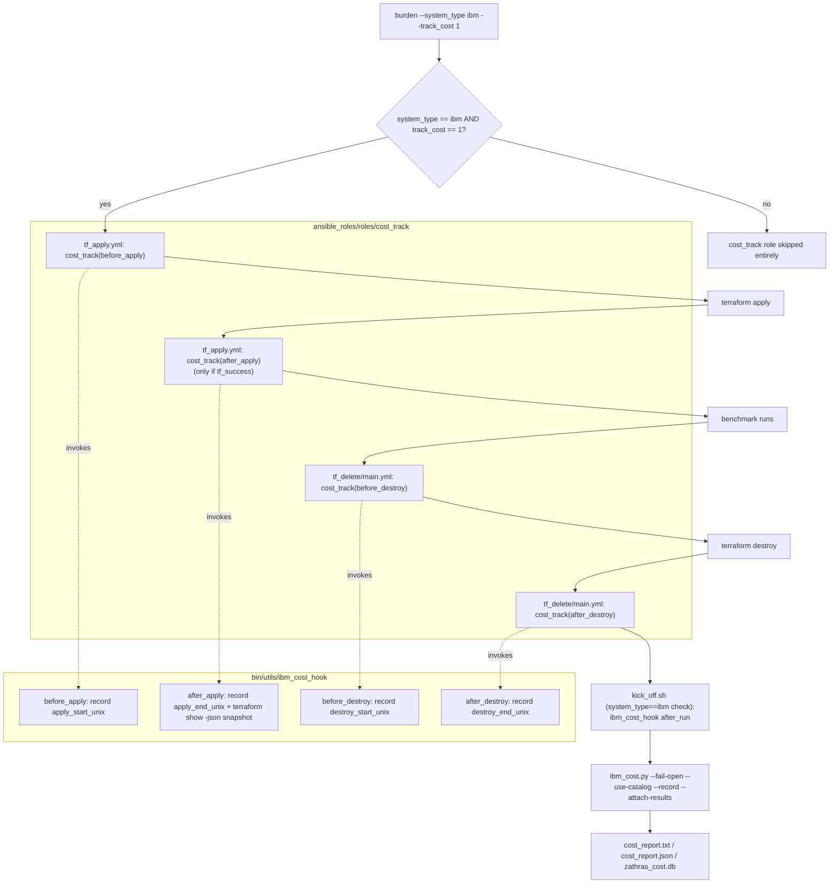
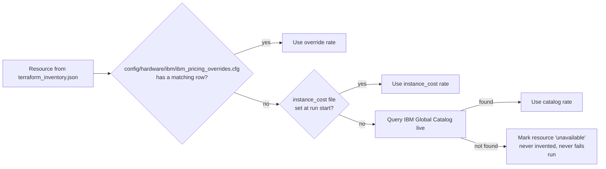
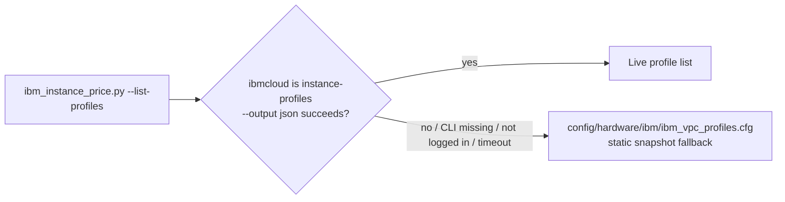

# Decisions Made — PR #575 Code Review Fixes (IBM Cloud Cost Tracking)

Source: review from `dvalinrh` on https://github.com/redhat-performance/zathras/pull/575
(branch `ibmcosttracking`). Each entry: decision, rationale, alternatives considered.

## 1. Terraform tag deduplication

**Decision:** Added a single `local.zathras_tags` in `main.tf` and reused it in all
four resources that tagged with `[var.User, var.Project, var.run_label,
"zathras_run_id:${var.run_label}"]` (`main.tf` x3, `disks.tf` x1).

**Why:** The literal tag list was duplicated four times; a future change to the
tagging scheme meant editing four places and risking drift. Terraform `locals`
don't need an Ansible `set_fact` (the reviewer's suggestion used Ansible
terminology, but these are `.tf` files) — the direct equivalent is a `local`
value referenced across files in the same module.

**Alternatives considered:** A `variable` instead of `local` — rejected, nothing
outside the module needs to override the tag list.

## 2. Gate the cost-tracking hook to IBM only

**Decision:** Added `config_info.system_type == 'ibm'` to the `when:` conditions
on all four `cost_track` role includes (`tf_apply.yml` x2, `tf_delete/main.yml` x2).

**Why:** `tf_apply.yml`/`tf_delete/main.yml` are shared across every cloud
provider (aws, azure, gcp, ibm). The hook was previously gated only on
`track_cost`, so turning on `--track_cost 1` for any provider would have
invoked `ibm_cost_hook` even on non-IBM runs. `bin/kick_off.sh` already guards
its own call to the hook with `[[ $_cost_type == "ibm" ]]` (line 334) — this
change makes the Ansible side consistent with that existing pattern.

**Alternatives considered:** Making `cost_track`'s own task self-check
`system_type` instead of the caller — rejected; keeping the gate at the call
site matches how `kick_off.sh` already does it and keeps `cost_track` reusable
if another provider adds cost tracking later.

## 3. Rename `bin/zathras_cost` → `bin/zathras_ibm_cost`

**Why:** The tool is IBM-specific (wraps `ibm_cost.py`); the name should say so.
No other file referenced the old path, so this was a pure rename + docstring
update.

## 4. Rename `bin/utils/zathras_cost_hook` → `bin/utils/ibm_cost_hook`

**Why:** Same reasoning as #3. Updated both callers: `ansible_roles/roles/cost_track/tasks/main.yml`
and `bin/kick_off.sh`.

## 5. Move IBM pricing/profile config under `config/hardware/ibm/`

**Decision:** Moved `config/ibm_vpc_profiles.cfg` and
`config/ibm_pricing_overrides.cfg` to `config/hardware/ibm/`.

**Why:** `config/` was becoming a flat dump of hardware-vendor-specific files.
A `config/hardware/<vendor>/` layout scopes future provider-specific config
(Azure, AWS, etc.) without polluting the top-level directory. Updated the two
path references in `ibm_instance_price.py` and `ibm_cost.py`, plus the README.

## 6. `--list-profiles`/`--price-all` now prefer a live IBM lookup

**Context investigated before deciding:** `config/hardware/ibm/ibm_vpc_profiles.cfg`
is **only** read by `load_known_profiles()`, which is used solely by
`--list-profiles` and `--price-all` enumeration. Normal per-run pricing (the
`kick_off.sh` cost path) queries the IBM Global Catalog directly by whatever
profile name is passed on the CLI — it never consults this file. So a brand
new IBM profile already prices correctly today; it just wouldn't show up when
someone asks to enumerate "all known profiles."

**Decision:** `load_known_profiles()` now tries `ibmcloud is instance-profiles
--output json` first (15s timeout) and only falls back to the static
`ibm_vpc_profiles.cfg` snapshot if that fails (CLI missing, not logged in,
timeout, bad output). Never raises on the live-lookup path — failure is
silent and falls through, consistent with the rest of the cost plugin's
fail-open design.

**Why this option over the alternatives:**
- *Live API fetch (chosen)* — always current, no file to maintain. The
  `ibmcloud` CLI is already a listed prerequisite for the `ibm_create` role
  (see README), so this adds no new tooling dependency, only a runtime call
  that's limited to the enumeration commands.
- *Manual refresh script* — rejected: still goes stale between runs, and is
  one more script someone has to remember to execute and commit.
- *Static file + just document the gap* — rejected: doesn't fix the drift,
  only explains it.

**Tradeoff accepted:** `--list-profiles`/`--price-all` now require
`ibmcloud` CLI + login to get the live list; without it they silently fall
back to the (possibly stale) bundled snapshot rather than erroring, so the
commands keep working either way.

## 7. Documentation

**Decision:** Added a "With Cost Tracking" example to the README's `## Usage`
section (`--track_cost 1` + `./burden cost --latest`), and fixed the
`config/ibm_pricing_overrides.cfg` path reference in the existing "Cost
tracking" section to the new `config/hardware/ibm/` location.

**Why:** The reviewer's top-level comment ("Need to update documentation
also") was non-specific. Checked `bin/burden`'s `--usage`/`--help` text —
`--track_cost 0/1` was already documented there (`bin/burden:3596`) with a
clear one-line description, so no change was needed there. The gap was in
the README's step-by-step `## Usage` examples, which didn't show
`--track_cost` alongside the other basic invocation patterns.

---

## Flow: IBM cost tracking (after these fixes)

### Pricing resolution order (`ibm_cost.py`)

### Profile enumeration (`--list-profiles` / `--price-all` only)

